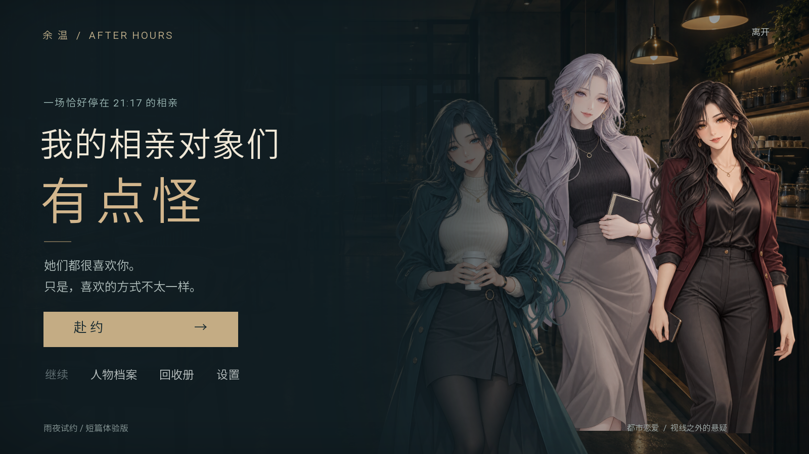

# 我的相亲对象们有点怪

**雨夜试约 · Ren'Py 视觉小说作品 Demo**

一位编辑，在雨夜咖啡馆收到三份同一时间的相亲邀请。坐在对面的，是三位穿着现代都市服装、性格各异的成年女性。只在他低头、转身或望向窗外之后，读者才会看见日常出现了一点无法解释的偏差。

本项目面向 HR / 作品集展示，目标是在 **5–8 分钟的单周目**中展示人物写作、分支叙事、氛围演出和完整的交互闭环。使用 **Ren'Py 8.2.0** 运行与打包，逻辑画布为 1600 × 900；游戏界面、存读档与剧情均在 Ren'Py 中实现。

## 先体验

**[直接下载 Windows Demo](https://github.com/Souldssr/strange-dates-demo/releases/latest/download/StrangeDates-1.0-win.zip)** · [查看最新发布](https://github.com/Souldssr/strange-dates-demo/releases/latest)

**HR / 玩家：请从本仓库的 Releases 下载 `StrangeDates-1.0-win.zip`。** 解压完整压缩包后，双击其中的 **StrangeDates.exe**，无需安装 Ren'Py 或 Python。同目录的 **README-HR.html** 是可离线打开的作品说明。

GitHub 的「Code → Download ZIP」提供源码；可直接运行的 Windows 版放在 **Releases → 最新版本 → Assets** 中。本机生成的发行包则位于 `dist` 目录。

新仓库只保存脱敏后的当前源码和干净的初始提交，不上传本机原有的开发提交历史。



首次建议：点击「赴约」，按直觉完成两次对话选择，最后选择一位同行者。抵达结局后，可用「再选一次」直接比较其他收束，也可以查看「回收册」。前置选择影响回应的语气，不会锁死恋爱路线。

| 操作 | 功能 |
| --- | --- |
| 左键 / 空格 | 推进对话 |
| 滚轮向上 / 「后退」 | 回看前一句 |
| Esc / 右键 | 打开设置 |
| H | 隐藏界面 |
| Ctrl / 「快进」 | 跳过已读对话 |
| 对话框底部按钮 | 回看、自动播放、存档、读档 |

设置中可调整文字速度、自动播放间隔、音量、窗口 / 全屏，并可关闭动态雨丝。内容以日常恋爱和氛围悬疑为主，没有实体怪物、血腥画面或突发惊吓。主角与三位相亲对象均为成年人；本 Demo 没有角色配音。

## 内容与设计

- **三次短约会**：珂澜的耐心、犹夏对未知的期待、奈亚对真实关系的试探，分别形成完整的情绪弧线。
- **视线之外**：主角离开视觉焦点后，隐藏人物立绘、降低环境明度，并用空镜文字与声音切换叙事视角。读者知道的比主角多一点，恐怖始终留在想象中。
- **轻量选择**：两次共通选项改变共鸣及异常察觉；最后一次选择决定同行者。共有三条恋爱结局和一条独自离席结局，离席也是被尊重的选择。
- **可回收的演示闭环**：结局记录跨周目保存；结局页可以直接重选，适合在短时间内查看不同路线。

按实际可达路径统计，单周目正文约 **1,957–2,066 汉字**，含选项和章节卡约 **2,177–2,288 汉字**；正文约 149–154 段。时长受阅读速度与停留时间影响，不是配音定长。

| 人物 | 都市身份 | 克系原型 | 保留并改写的意象 |
| --- | --- | --- | --- |
| 珂澜 · 26 岁 | 海洋声学研究员 | 克苏鲁 / Cthulhu | 深海、梦、沉眠 → 学着醒来赴约 |
| 犹夏 · 25 岁 | 建筑设计师 | 犹格·索托斯 / Yog-Sothoth | 门、时空、可能性 → 愿意接受未知 |
| 奈亚 · 27 岁 | 品牌创意顾问 | 奈亚拉托提普 / Nyarlathotep | 信使、多重形象、戏谑 → 下班后成为自己 |

**用语说明**：项目统称三者为「克系原型」。Great Old Ones（旧日支配者）与 Outer Gods（外神）是不同的分类术语，不将所有对象混称为同一类别；本作的人类身份、恋爱性格和现代情节是改写，不是神话设定考据。意象参考原作：[《克苏鲁的呼唤》](https://www.hplovecraft.com/writings/texts/fiction/cc.aspx)、[《敦威治恐怖事件》](https://www.hplovecraft.com/writings/texts/fiction/dh.aspx)、[《梦寻秘境卡达斯》](https://www.hplovecraft.com/writings/texts/fiction/dq.aspx)。

## 开发入口

克隆或下载源码后，用 Ren'Py Launcher 打开项目根目录即可识别项目，也可在项目根目录的 PowerShell 中执行下列脚本。开发需要自行安装 [Ren'Py SDK](https://www.renpy.org/release_list.html)，本项目已使用 8.2.0 验证。

| 文件 | 负责内容 |
| --- | --- |
| [game/story.rpy](game/story.rpy) | 正文、共鸣变量、两次共通选择、最终选择与四个结局 |
| [game/core.rpy](game/core.rpy) | 角色定义、图像映射、人物位置、雨丝绘制、人物档案 |
| [game/screens.rpy](game/screens.rpy) | 标题、对话、选项、设置、存读档、历史、回收册与结局页 |
| [game/options.rpy](game/options.rpy) | 窗口、版本、字体以外的全局设置、持久状态、发行包规则 |
| [tools/build.ps1](tools/build.ps1) | 运行、Lint 与 Windows 发行包构建 |
| [tools/smoke.py](tools/smoke.py) / [tools/smoke.rpy](tools/smoke.rpy) | 在独立测试镜像内运行 Ren'Py testcase 并保存截图、日志 |
| [tools/make_atmosphere.py](tools/make_atmosphere.py) | 重新生成程序合成声音和几何 UI 贴图 |
| [docs/art-prompts.txt](docs/art-prompts.txt) | 美术生成提示词、原始输出位置、尺寸及透明通道记录 |

代码保留中文注释，重点解释状态用途、分支目的、叙事视角切换、界面布局和构建隔离。剧情中的 `before_final_choice` 是结局重选入口；`resonance_k / resonance_y / resonance_n` 只影响亲密对白；`noticed` 调整主角对已知异常的描述；`persistent.endings` 负责跨周目回收记录。

### 运行、检查与打包

```powershell
# 先在 PowerShell 中进入下载或克隆的项目根目录。

# 启动当前源码。
.\tools\build.ps1 -Action Run

# 检查脚本、资源引用和 Ren'Py 语法。
.\tools\build.ps1 -Action Lint

# 先执行 Lint，再生成 dist 目录内的 Windows ZIP。
.\tools\build.ps1 -Action Build
```

脚本优先查找项目内 `.tools\renpy-8.2.0-sdk`，再读取 `RENPY_SDK` 环境变量。也可以显式指定 SDK：

```powershell
.\tools\build.ps1 -Action Run -Sdk 'C:\path\to\renpy-8.2.0-sdk'
```

开发用存档和日志留在 `build` 下。发行包包含 Ren'Py 运行时，不要求 HR 另外安装 Python 或 Ren'Py。打包文件名以 `dist` 中实际生成的 ZIP 为准；SDK、测试镜像、构建历史和开发脚本不会随游戏分发。

### 冒烟测试

使用 Ren'Py SDK 自带的 Python，避免依赖系统 Python。以下命令适用于项目内已经备好 SDK 的环境：

```powershell
$bundledPython = '.\.tools\renpy-8.2.0-sdk\lib\py3-windows-x86_64\python.exe'
& $bundledPython '.\tools\smoke.py'
```

使用外部 SDK 时，同时指定 Python 和 SDK 位置：

```powershell
$sdkPath = 'C:\path\to\renpy-8.2.0-sdk' # 替换为自己的 SDK 目录。
$bundledPython = Join-Path $sdkPath 'lib\py3-windows-x86_64\python.exe'
& $bundledPython '.\tools\smoke.py' --sdk $sdkPath
```

测试在 `.qa` 中新建独立工程，默认执行 `portfolio_ui` 与 `complete_story`，输出结果至 `build/qa-results.json`、`build/qa-*.log` 和 `build/screenshots`。测试用脚本不进入正式发行包；通过日志退出码判定结果，不以单张截图代替运行验证。

## 如何修改

**改对白或分支**：编辑 `game/story.rpy` 中对应的角色段落或 `ending_*` 标签，保留 Ren'Py 缩进规则。修改选项后同步检查共鸣变量与测试选项文本。

**改人物或场景图**：替换 `game/images/kelan.png`、`youxia.png`、`naiya.png`、`cafe.png`；人物 PNG 应保留透明通道。显示比例及位置在 `game/core.rpy`，标题页人物排布在 `game/screens.rpy`。不要将按钮或标题烘焙进原画。

**改声音与界面颜色**：声音资源在 `game/audio`；合成参数在 `tools/make_atmosphere.py`。该生成器需要 NumPy 和 Pillow。文字颜色、字号和按钮布局在 `game/screens.rpy`，几何 UI 贴图由生成器输出至 `game/gui`。

**提交习惯**：每完成一项可解释的逻辑修改，先做适合该修改的检查，再用中文说明提交 Git；避免将不相关的剧本、美术、界面修改堆进同一条提交。生成日志、临时测试目录和开发 SDK 不提交。

## 素材来源与 AI 协作披露

| 部分 | 来源与制作方式 |
| --- | --- |
| 视觉方向 | 用户提供风格参考图；提取半厚涂二次元、细致长发、深宝石色和金属细节，服装改为现代都市穿搭 |
| 三名人物立绘与咖啡馆背景 | 使用 OpenAI 图像生成工具制作，原始输出与提示词有记录；不声称由人工手绘 |
| 雨声、环境铺底、提示音 | `tools/make_atmosphere.py` 程序合成，无外部音频采样 |
| 遮罩、对话框、图标等几何素材 | 同一 Python 工具程序绘制 |
| 中文字体 | Ren'Py 所附 Source Han Sans Lite；SIL Open Font License 1.1，原许可与元数据置于 `licenses` |
| 引擎 | Ren'Py 8.2.0；许可说明随 `licenses/RenPy-LICENSE.txt` 保留 |
| 剧本、交互界面、代码及文档 | 根据用户目标使用 Codex 协作生成、整合与检查 |

这是 AI 协作的作品 Demo。作品集可补充作者署名，并说明自己负责的选题、设计决策、审阅和后续修改；美术提示与程序实现均保留在源码中，方便复盘制作过程。

## 完成验证

2026-10-10 已完成：

- Ren'Py 8.2 Lint 通过，无脚本或资源错误。
- `portfolio_ui` 通过：标题、三个人物档案、设置、作品说明、三位人物对话、空镜、存档；真实保存状态 41，修改为 99 后读档恢复 41。
- `complete_story` 通过：共通剧情推进、三条恋爱结局、离席结局、结局重选，以及回收册四个结局齐全的断言。
- 解压 Windows 发行包后，使用包内自带运行时重复通过两组测试；`StrangeDates.exe --version` 启动器检查通过。
- 17 张 1600×900 实际引擎截图已经复核，修复了字体缺字与两处布局间距问题。
- 发行包保留源码、字体和引擎许可证，不包含开发 SDK、测试脚本或测试存档。

可核验材料：`build/qa-results.json`、`build/qa-*.log`、`build/lint.txt` 与 `build/screenshots/`。保存于 Git 的交付验证摘要见 `docs/verification.json`。
